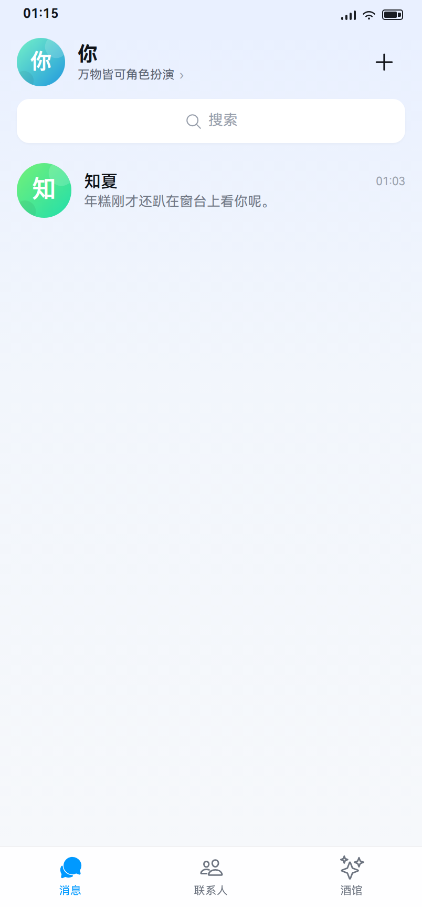
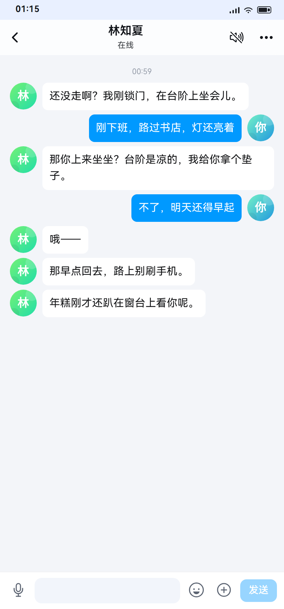
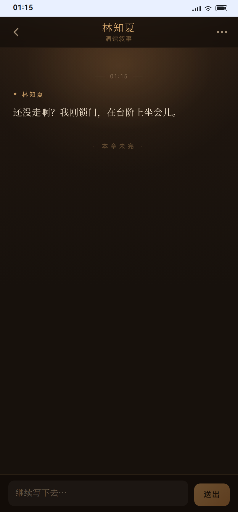
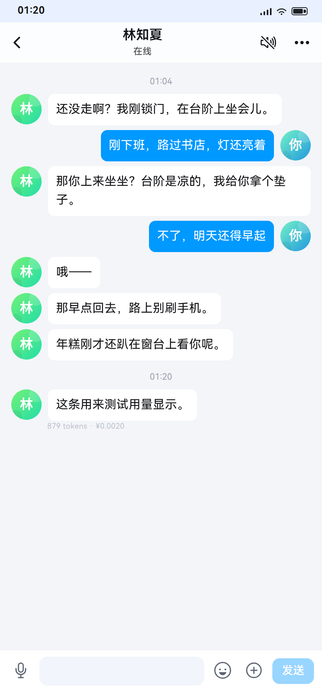

# Q伴 / QPersona

> 看起来是 QQ，用起来也是 QQ —— 但好友列表里全都是 AI 角色。

一个本地优先的 AI 角色扮演客户端：以 QQ 为交互外壳，以 SillyTavern V2 角色卡为角色人格内核，
用聊天记录统计蒸馏来造角色。项目真正的技术含量不在 UI 复刻，而在**调度层**——
同一张角色卡在 QQ 短消息与酒馆叙事两种场景里共享设定与记忆，但注入不同的提示词。

<p>
  
  
  
  
</p>

- 开源、非商业，仅用于学习与技术演示
- 不连接真实 QQ 协议，不添加真实好友，所有数据存在本地
- 界面风格致敬 QQ，相关素材版权归腾讯所有

---

## 现在能做什么（v0.13.1）

| 模块 | 状态 |
| --- | --- |
| QQ 9 风格外壳：浅色渐变、头像资料头、搜索胶囊、三 tab（消息 / 联系人 / 酒馆） | ✅ |
| 消息列表：长按置顶 / 免打扰 / 删除、未读角标、正在输入 | ✅ |
| 单聊：流式回复、打字动画、时间分隔、QQ 短消息自动拆气泡（可关） | ✅ |
| QQ 端去 AI 味提示词：短句、不许旁白 / 客服腔 / 总结腔，[设计说明](docs/prompts/qq-anti-ai.md) | ✅ |
| 聊天：表情面板、拍一拍、消息长按（复制 / 朗读 / 删除 / 重新生成）、浏览器语音输入 | ✅ |
| 酒馆：**独立的叙事界面**（烛光纸页、衬线排版、无 QQ 气泡）与 QQ 端共用角色卡 | ✅ |
| 加好友：导入 V2/V3 角色卡（JSON/PNG）+ 预览，自定义建角色 | ✅ |
| 我的：左侧滑出抽屉（左滑 / 点空白 / × 关闭），编辑资料与统计 | ✅ |
| 自定义头像：自己的、角色的、新建角色的都能换 | ✅ |
| 设置：主题（浅/深/跟随系统）、字号、气泡配色、提示音、自动拆气泡、显示时间 | ✅ |
| 数据：导出 JSON、清空聊天、清除全部数据、存储占用 | ✅ |
| 搜索：角色、签名、标签、QQ 号、聊天记录全文 | ✅ |
| AI：多方案、7 个能力槽位、连接测试、角色级模型覆盖、语音朗读 | ✅ |
| 用量：每条回复下面显示 token 与估算花费（可关，单价可覆盖） | ✅ |
| 记忆：6 类记忆、按 20/40/80 条或按时间异步总结、关键词 + importance 召回 | ✅ |
| 主动消息：概率 + 安静时长 + 免打扰时段，按会话开关，久未联系时换语气 | ✅ |
| 外观：7 种气泡、文字风格、聊天背景、个人/角色主页封面、主题包导入导出 | ✅ |
| 自定义表情包：上传 / 命名 / 给 AI 的注解，发送时渲染图片，模型收到文字注解 | ✅ |
| 消息引用、文件发送、链接卡片、数据导入 | ✅ |
| 群聊：建群、@ 选择器、5 分钟活跃窗口（可调）、最多 2 人顺序回复、静默零调用 | ✅ |
| 群设置：群名、群头像、成员增删、唤醒时长、上下文隔离、成员免打扰 | ✅ |
| 群聊 ↔ 私聊记忆互通：群里的记忆带来源标签，私聊可召回；可关闭私聊记忆进群 | ✅ |
| AI 语音通话：按住说话 → STT → 模型 → TTS，浏览器能力兜底，通话页可静音/挂断 | ✅ |
| 聊天记录蒸馏：txt/粘贴 → 统计 → 草稿 → 两轮反馈 → 保存；没记录可凭印象写 | ✅ |
| 图片 / 视频 / 语音消息：发送与渲染；语音用麦克风录制、点开播放 | ✅ |
| 「更多」面板用真图标；拍一拍改为双击对方头像 | ✅ |
| AI 也能发表情包：模型输出 `[表情:名字]`，从用户表情库里挑 | ✅ |
| AI 设置一键拉取 `/models` 可用模型；可标记模型支持图片输入 | ✅ |
| 图片识别：vision 槽位生成描述，或主模型多模态直接看图 | ✅ |
| 聊天记录蒸馏（上传 → 解析 → 统计 → 两轮反馈） | 🚧 Phase 2 |
| 群聊（兴趣值 + 激活/屏蔽） | 🚧 Phase 3 |
| 记忆总结（memory_summary 槽位） | 🚧 Phase 3 |
| 图片 / 文件消息、WebRTC 通话、屏幕共享 | 🚧 Phase 4 |

首次打开会自动创建一个演示角色「林知夏」，可以直接点进去看聊天界面；
不配模型也能看到完整的 UI，发消息会提示你去 AI 设置里填接口。

---

## 部署

纯前端，可直接挂静态托管；不需要服务器，也不需要学生优惠。步骤见
[deploy.md](docs/deploy.md)。

## 快速开始

```bash
pnpm install
pnpm dev          # http://localhost:5173
pnpm build        # 产物在 dist/，可静态部署
pnpm typecheck
pnpm test:smoke   # 三组冒烟测试：核心逻辑 / Dexie 存储 / 假模型 SSE 端到端
```

手机和电脑在同一局域网时，可以 `pnpm dev` 后用手机访问电脑的 `http://<IP>:5173`。
数据存在浏览器 IndexedDB 里，换浏览器 / 清缓存 = 重置。

### 配置模型

1. 「我的 → AI 设置 → 添加模型方案」
2. 填 Base URL、API Key、模型名（面板里有 DeepSeek / OpenAI / 硅基流动 / Ollama 的快捷预设）
3. 点「测试」确认连通，再保存
4. 回到聊天，直接发消息

> 每个角色都可以在「角色资料」里覆盖槽位绑定；不填就用全局的。

---

## 架构：三层，但不过度抽象

```
src/
├─ core/                 # 与 UI 无关的领域层
│  ├─ types.ts           # 角色卡 / 会话 / 消息 / 槽位 / API 方案
│  ├─ pricing.ts         # token 估算与花费换算
│  ├─ card.ts            # parsecard 封装：V2/V3 + PNG 解析、导出、自定义建卡
│  ├─ prompt.ts          # ★ 调度层：qq_profile / tavern_profile 两套提示词
│  ├─ llm.ts             # OpenAI 兼容流式适配器（SSE）
│  ├─ db.ts              # Dexie / IndexedDB（characters / conversations / messages / profiles / kv）
│  ├─ avatar.ts          # 无资源头像（SVG dataURL）
│  ├─ demo.ts            # 内置演示角色
│  └─ util.ts
├─ store/                # Pinia：settings / contacts / chat
├─ ui/
│  ├─ chat/              # ChatRoute（按 profile 分流）· ChatPage · TavernChat · MessageItem · Composer
│  ├─ pages/             # 消息 / 联系人 / 我的 / 设置 / AI 设置 / 角色资料 / 酒馆 / 搜索 / 编辑资料
│  ├─ add/               # 添加好友（导入 / 新建 / 蒸馏入口）
│  ├─ common/            # StatusBar / Avatar / BottomSheet / Toast
│  └─ shell/             # BottomNav
└─ styles/base.css       # 设计变量 + 通用组件样式
```

**交互层**（`ui/`）只发事件、只渲染数据，不知道模型是什么。
**调度层**（`store/chat.ts` + `core/prompt.ts`）决定这条消息发给谁、用哪个 profile、注入哪些记忆。
**能力层**（`core/llm.ts`）只负责把 token 吐出来，不关心自己是 GPT 还是 DeepSeek。

---

## 关键设计决策（记录理由）

1. **技术栈 Vue 3 + Vite + Pinia + Dexie**：参考资源几乎都是 Vue 生态；纯前端 + IndexedDB
   可以做到「打开网页就能用」，不需要跑后端进程。后续若要接 SQLite / 本地服务，`core/db.ts` 是唯一要换的地方。

2. **消息渲染层复用 [fake-qq-ui](https://github.com/Redlnn/FakeQQ-UI)**，外壳（列表 / 导航 / 设置 / 添加页）自建。
   气泡颜色、暗色变量、后续的语音/文件/转发消息都能直接沿用，避免手写一套 QQ 气泡 CSS。
   仅引入其构建好的 CSS，再按手机尺寸覆盖 `--qq-avatar_size_2` 等变量。

3. **角色卡解析用 [parsecard](https://www.npmjs.com/package/parsecard)**（零依赖、浏览器可用），
   自动兼容 V2 / V3 与 PNG `tEXt` 内嵌卡，不自己手写兼容逻辑。项目自有字段写入 `extensions.qpersona`，
   导出时能原样 round-trip。

4. **会话（Conversation）携带 `profile`**：同一角色在 QQ 端和酒馆端是两条会话，但共用一张角色卡。
   提示词不塞进同一个 system prompt 让模型自己判断——调度层在组装请求时二选一，避免模型在 QQ 里滑回酒馆腔。

5. **QQ 端回复自动拆气泡**：模型一次回多行时，按行拆成 2~4 条消息、间隔 220ms 依次出现；
   太长（>70 字/行）或行数过多则保持一条，避免刷屏。

6. **hash 路由**：`/#/tavern` 在任何静态托管（GitHub Pages、本地文件）都不会 404，同时保留独立路由语义。

7. **头像零资源**：没有立绘时按名字哈希生成 SVG 渐变头像，离线可用、颜色稳定。
   PNG 角色卡则直接压到 320px 后作为头像存本地。

8. **未配置模型时不阻塞 UI**：发送后会出现一条错误气泡引导去 AI 设置，而不是弹窗打断。

9. **外壳向 QQ 9 靠拢**：参考真实 QQ 9 的界面（浅色渐变顶栏、左上角头像 + 昵称 + 签名、白色搜索胶囊、
   右上角「+」九宫格菜单、未读角标挂在头像右上角、三 tab 底部导航）。「我的」从底部导航移到头像入口，
   第三个 tab 留给酒馆。实现依据来自公开的 QQ 9 界面截图与体验文章，不复制任何素材文件。

10. **酒馆聊天界面与 QQ 分开**：`/chat/:id` 先按 `conversation.profile` 分流到 `ChatPage` 或
    `TavernChat`。酒馆端不用气泡、不显示头像，改成烛光背景 + 衬线正文 + 「你」的侧注，
    让「换一套语法」在视觉上也成立。

11. **能落地的按钮都落地**：搜索、置顶、免打扰、拍一拍、表情、语音输入、朗读、导出/清空数据都是真功能；
    暂未实现的（图片/文件/通话、群聊、蒸馏）在入口上明确标注「即将推出」，不做假装能用的按钮。

12. **token 用量与花费是「顺手可选」的信息**：请求时带 `stream_options.include_usage`，优先用供应商回传的
    真实 usage；拿不到就按字数估算（估算结果前面带 `≈`）。价格优先读方案里填的「输入/输出单价」，
    留空则按模型名内置价目表估算，所有金额只在本机计算，不随请求外发。显示开关在「设置 → AI 与自动化」。

13. **侧栏是抽屉，不是跳页**：点左上角头像拉出左侧抽屉，支持左滑、点遮罩、点 × 三种退出方式。
    抽屉里放资料、统计和常用入口，避免「进去出不来」。

15. **记忆先落盘再总结**：每轮回复后由 `chat.respond` 触发，`maybeSummarize` 在后台队列里跑，
    不阻塞聊天；游标存在会话的 `memoryLastTs` 上，失败不会重复烧钱。召回用中文二元组命中 + importance，
    不依赖 embedding，注入位置在 system 之后、历史之前。

16. **表情包的注解是给模型看的**：库里存图片 + 名字 + 一句注解，界面渲染图片，
    写进历史时变成 `[表情包：猫猫无语，表示懒得接话]`。这样即使不接视觉模型，AI 也接得住梗。

18. **卡片消息走「更多 → 卡片」**：填标题 / 链接 / 描述，消息里渲染成白色链接卡，
    提示词里变成 `[卡片：标题] 描述（url）`。不做抓取网页元信息，避免额外请求和跨域麻烦。

19. **群聊先用共享上下文跑通**：多人对话没法用 OpenAI 的 user/assistant 二分角色表达，
    所以把最近 30 条压成一份「群聊记录」放进 user 消息，并明确「现在轮到你」。先保证成本可控（最多 2 人、
    没人被叫到就零调用），按成员隔离游标留到 3.2。

20. **富媒体存在消息里**：图片压到 1280px 存 dataURL，视频限制 8MB，语音用 MediaRecorder 录成 dataURL。
    好处是完全离线、备份即完整；代价是单条消息较大，后续可以换成 Blob 分表存储。

17. **非文本消息统一走 `historyText`**：引用拼成 `[引用 名字：「…」]` 前缀，文件变成 `[文件：名字]`。
    渲染层和提示词层拆开，新增消息类型时只改这一个函数和对应组件。

14. **QQ 端提示词单独做了一份去 AI 味的版本**：把「短句、不总结、不复述、不客服腔、不读心、有自己的生活」
    写成可执行规则，并附三条反例和一句发送前自检。设计依据与调参说明见
    [docs/prompts/qq-anti-ai.md](docs/prompts/qq-anti-ai.md)。酒馆端不复用这套规则。

21. **看不见就说看不见**：官方 DeepSeek 聊天接口是纯文本的，图发过去它也看不到。
    提示词明确要求「确实看不到就直接说看不到，不要编图里的内容」——这是人味，不是 bug。
    想让它真的看见：在「AI 设置」里把主模型标记为「支持图片输入」，或给「图片识别」槽位配一个视觉模型，
    应用会先生成一句描述再交给文本模型。

22. **AI 发表情包用文本指令而不是图片生成**：系统提示词里列出用户表情库的名字与注解，
    模型想发时单独输出一行 `[表情:猫猫无语]`；客户端匹配到名字就替换成真实表情消息，
    匹配不到就当普通文字。零额外模型调用，也不会生成不存在的图。

23. **模型列表是问出来的**：AI 设置里「获取可用模型」请求 `{baseUrl}/models`，把返回的 id 列成可点的候选，
    不靠预先维护的型号表——OpenAI 兼容服务那么多，猜名字没有意义。

24. **群聊的「活跃」是一个五分钟窗口**：被 @、叫到名字或聊到兴趣的角色会写入 `activeUntil`，
    窗口内即使没人叫它也会继续接话（4 秒冷却、最多两人），发一句就续 5 分钟；窗口过期后完全静默。
    时长在群设置里可选 1/3/5/10/30 分钟。这样既不会「_at 一下就消失」，也不会一直烧钱。

25. **@ 是选出来的**：输入框里打 `@` 会浮出成员列表，选中后插入 `@昵称 `，不需要手打名字；
    「更多 → 提到成员」也保留。激活匹配会认 `@昵称`、角色名、别名。

26. **群聊和私聊共用一份记忆，但标来源**：记忆按 `characterId` 存，不按会话隔离；
    群聊总结出的记忆带 `source='group'`，召回时显示 `[群聊]` 前缀，私聊里也能用。
    群设置可以关闭「私聊记忆进群」。群聊总结只让当轮发言的角色做，最多两人，避免一次群聊烧 N 份钱。

27. **语音通话是本地闭环，不上 WebRTC**：按住说话 → STT → 文本模型 → TTS → 播放。
    `stt` / `tts` 槽位优先，没配置就用浏览器的识别与朗读；通话轮次照常写进聊天和记忆。
    选型理由见 [rtc-research.md](docs/rtc-research.md)。

28. **蒸馏坚持「先数再写」**：解析 txt → 统计句长/标点/口头禅/高频原话 → 带着原话样本写草稿 →
    用户两轮建议各改一版 → 定稿。拿不到记录时提供「凭印象写几句」的兜底，不硬编背景；
    获取方式见 [qq-export.md](docs/qq-export.md)。

29. **记忆总结不再每 10 条触发**：默认每 40 条，可在设置里选 20/40/80/120 条，
    或改成「按时间」（30/60/120/240 分钟，且至少 5 条新消息）。手动「立即整理」不受限制。
    群聊用同一套频率，但只看当轮发言角色。

30. **主动消息是概率事件**：全局开关 + 每个角色开关；到「安静时长」后按概率掷骰，
    最多一分钟触发一条。生成时带最近上下文和记忆，明确要求不要「在吗」式开场。
    没开就永远不调用模型。

31. **主页背景和聊天背景都存本地 dataURL**：个人主页、角色主页、聊天窗口各一份；
    聊天背景加半透明遮罩保证文字可读。主题色按用户反馈移除，只保留气泡配色。
32. **主题包是 Q伴 自己的 JSON**：打包主题、字号、气泡、文字风格、聊天背景；
    QQ 主题包是私有格式，不直接兼容，但可以把里面的背景图拿出来单独上传。见
    [theme-packs.md](docs/theme-packs.md)。
33. **群聊隔离与免打扰是可选开关**：群设置里可以开「严格上下文隔离」（每人只读自己上次发言之后
    + 最近 10 条），也可以单独把某个成员设为免打扰；默认隔离开、免打扰关。
34. **主动消息的免打扰时段**：默认 23:00–08:00 不发；每个会话还有独立开关。
    安静超过 6 小时再触发时，提示词会切到「很久没联系」的语气，避免每次都像日常问候。

---

## 数据模型

角色卡以 SillyTavern V2 为基线（`name / description / personality / scenario / first_mes /
mes_example / system_prompt / post_history_instructions / alternate_greetings / character_book / tags …`），
项目扩展放在：

```ts
ext: {
  qq: { qqNumber, nickname, signature, avatar, interests[], aliases[] },
  prompts: { qq?, tavern? },        // 自定义提示词，留空用内置模板
  routing: { [slot]: apiProfileId }, // 角色级模型覆盖
  toggles: { chat, memory },         // 主对话 / 记忆总结开关
  origin: 'import' | 'custom' | 'distill',
}
```

消息表按 `conversationId + ts` 排序；会话列表按置顶 + 最近时间排序。

---

## 路线图

- **已完成（0.13.1）**：记忆系统、自定义表情包、消息引用、文件发送、链接卡片、数据导入
- **下一步 · 群聊 3.3**
  - 按成员 `seenTs` 做上下文隔离、单成员屏蔽
  - 设计见 [docs/group-chat.md](docs/group-chat.md)
- **下一步 · 屏幕共享与视频**
  - AI 侧：本地采集 + 截帧 + vision，不需要 WebRTC
  - 真人侧：1:1 用 PeerJS，多人用 LiveKit（含屏幕共享）
  - 选型与来源见 [docs/rtc-research.md](docs/rtc-research.md)，分阶段见 [docs/voice-and-screen.md](docs/voice-and-screen.md)
- **下一步 · 一起看视频**
  - 播放器 + 字幕时间轴 + 角色陪看，成本比连续视觉低一个数量级
  - 真人同步用 OpenTogetherTube / Syncplay，不自己写
  - 方案与成本对比见 [docs/watch-together.md](docs/watch-together.md)
- **之后 · 双端打磨**
  - 酒馆端更长上下文与叙事排版
  - 蒸馏草稿的手动编辑与角色卡导出
- **之后 · 体验细活**
  - 记忆的编辑/合并/时间衰减
  - 主动消息的内容触发（朋友圈、日程、长时间未打开）
  - 可选真人 RTC（PeerJS 1:1 / LiveKit 多人）
- **之后 · 语音增强**
  - 全双工、打断、降噪；通话记录导出

---

## 免责声明

本项目为个人学习与技术演示项目，不提供任何真实 QQ 服务，不涉及腾讯服务器。
界面中的 QQ 相关视觉元素版权归腾讯所有，本项目不用于商业用途。角色卡与对话内容由使用者自行负责。
